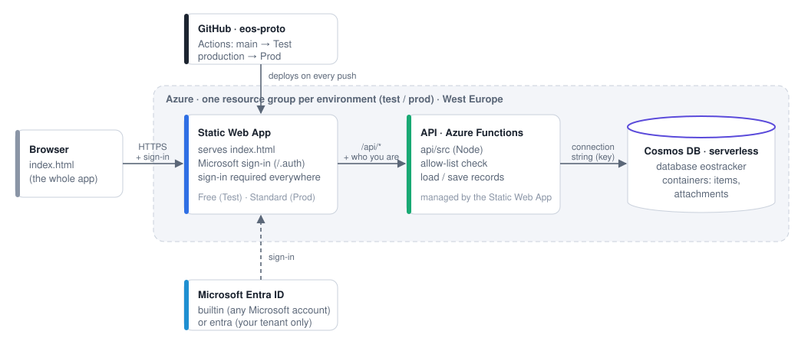

# EOS Tracker on Azure

How EOS Tracker runs on Azure, how the environments fit together, and how to create everything: by hand in the Azure portal, or with the Azure CLI and Bicep.

**In short:** the page (`index.html`) is hosted by **Azure Static Web Apps**. The data is in **Cosmos DB** (serverless), behind a small **API** (Azure Functions, managed by Static Web Apps). People sign in with their **Microsoft account** (Entra ID). After the one-time setup, updating is just `git push`. Test runs for about €0 a month, Prod for about €9.

---

## 1. Architecture



| Part | What it does | Where in the repo |
|---|---|---|
| **Static Web App** | Serves `index.html` and requires sign-in for every request (`staticwebapp.config.json`); hands the signed-in user to the API | `azure/staticwebapp.config.json` |
| **API** | `GET /api/config`, `GET /api/data`, `PUT`/`DELETE /api/items/{collection}/{id}`, `GET /api/attachments/{id}`. Checks the allow-list on every call; adds people automatically when they first sign in; moves pasted images into separate attachment records | `api/src/core.js` (logic), `api/src/index.js` (Azure + Cosmos glue) |
| **Cosmos DB** | One document per record (goal, rock, card, unit, person, plus one `meta` record with the data version) in container `items` (partition key `/type`); pasted images in container `attachments` | created by the API on first use, and by `infra/main.bicep` |
| **Sign-in** | Static Web Apps' built-in Microsoft sign-in. *Built-in* mode needs no keys; *Entra* mode locks it to your own tenant | §6 |
| **Deployment** | GitHub Actions workflow: copies `index.html` and the config into `dist/`, builds `api/`, uploads to the Static Web App | `.github/workflows/azure-deploy.yml` |
| **Infrastructure as code** | Bicep template for one environment, plus a PowerShell script that runs it | `infra/main.bicep`, `infra/deploy.ps1` |

### Cosmos DB: account, database, containers

Cosmos DB has three levels:
- **Account:** the Azure resource, e.g. `eostracker-test-ab12cd`.
- **Database:** `eostracker`.
- **Containers:** each holds JSON documents, comparable to tables. EOS Tracker uses two:

| Container | Holds | Partition key |
|---|---|---|
| `items` | every record as its own JSON document: one per person, unit (company, department, team, forum), goal, rock (milestones included) and card, plus one `meta` document with the data version | `/type` (`people`, `units`, `goals`, `rocks`, `cards`, `meta`) |
| `attachments` | pasted images, one document per image (named after its SHA-256 hash, so the same image is stored once) | `/id` |

**How the API can create them.** The API connects with the account's **connection string** (app setting `COSMOS_CONNECTION_STRING`). That string contains the account's primary key, which gives full control over that one Cosmos DB account. That's enough to create the database and containers on first use (`createIfNotExists`); no Azure role or extra permission is involved. Two consequences:
- **Treat the connection string as a password.** It lives only in the Static Web App's app settings, never in the repo.
- **If it ever leaks,** regenerate the key (*Cosmos DB → Keys → Regenerate*) and update the app setting.

When `infra/main.bicep` is used, the database and containers already exist, and the API's create step does nothing. Managed identities, which would avoid keys, aren't available for the API that Static Web Apps manages for you.

### How the page finds its backend

The same `index.html` runs everywhere. At start-up it asks `/api/config`:

| Where it runs | Backend | Data | Sign-in |
|---|---|---|---|
| Azure (the API answers) | **api** | Cosmos DB, shared by everyone | Microsoft account |
| Double-click, `serve.ps1`, GitHub Pages (no API) | **local** | this browser's localStorage only | simulated: pick a person in the top bar ("You") |
| Any of the above with `?backend=mock` | **mock** | the real API code (`api/src/core.js`) running in the browser, on a localStorage "database" | simulated: `dev@example.com`, or `&as=name@example.com` |

`?backend=local` forces local mode, even on Azure. A small tag next to the app name shows which mode you're in: **Local**, **Mock API** or **test**. Prod shows no tag. In local mode the browser logs one harmless 404 for `/api/config`.

### Roles: admins, members and people waiting for a team

Getting in has two steps. First the **allow-list** decides who may sign in at all (`ALLOWED_EMAIL_DOMAINS`, `ALLOWED_EMAILS`, §4). Then each person's **role** decides what they see:

| Role | Who | Sees and does |
|---|---|---|
| **Admin** | everyone in `ADMIN_EMAILS` (always, automatically), plus anyone an admin ticks "Admin" for | everything, plus the **Organisation** tab: add, rename, move and delete departments, teams and meetings; assign people to teams; make others admin |
| **Member** | anyone assigned to at least one unit (team, department, meeting or the company) | the whole app (goals, rocks, Level 10, Rock Review) |
| **Waiting** | signed in for the first time, not assigned yet | only "Welcome, you haven't been added to a team yet". The page checks every 30 seconds and opens the app once they're assigned |

- **New people add themselves** by signing in. They appear at the top of the Organisation tab, marked as waiting, and the tab shows how many are waiting. Assign them with *+ Add to…*.
- **Removing someone from every unit** puts them back to waiting. That's how you offboard someone while keeping their history.
- **Enforced by the server, not just hidden in the page:** a waiting person gets no data at all, and only admins can change the organisation or people.
- **Members currently see everything.** Per-team visibility is a possible later step.

### Saving and multiple users

- The page keeps all data in memory. After every change it sends **only the records that changed**, in the background. "Saving…" appears in the top bar while that happens.
- Every record carries an **ETag**. If someone else changed the same record in the meantime, the server refuses the save. The page then shows the latest version and says your change wasn't saved. Nothing is silently overwritten.
- Other people's changes are picked up when you return to the tab, and every minute while you're not editing.
- If the connection drops, the change stays pending and is retried every 5 seconds. The browser warns before you close a tab with unsaved changes.

### Data migrations are automatic

The data has a version (`DATA_VERSION` in `index.html`, stored in the `meta` record). When a new version of the page changes the data shape, the first person to open it converts the data and saves it back. The version number is written last, after all records are stored. There's never a manual migration step.

If an *older* page meets *newer* data (for example after rolling back Prod), it refuses to load rather than damage the data.

---

## 2. Environments: Dev → Test → Prod

| | **Dev** | **Test** | **Prod** |
|---|---|---|---|
| Where | your PC | Azure, resource group `rg-eostracker-test` | Azure, resource group `rg-eostracker-prod` |
| Page | `serve.ps1` → http://localhost:8080 (or double-click `index.html`) | `https://<name>.azurestaticapps.net` | same, or a custom domain |
| Data | sample data in the browser (local), or `?backend=mock` to exercise the API code | Cosmos DB, starts with **sample data** (`SEED=sample`) | Cosmos DB, starts with the **organisation only** (`SEED=org`) |
| Sign-in | simulated | Microsoft (built-in) + allow-list | Microsoft, locked to your tenant once the app registration exists (built-in until then) |
| Static Web Apps plan | – | **Free** | **Standard** |
| Updated by | saving the file | `git push` (branch `main`) | `git push origin main:production` |

Day to day:

1. Change the code and check it locally: http://localhost:8080. Use `?backend=mock` if you touched saving or the API. For server logic, run http://localhost:8080/tests/api-core.test.html.
2. `git push`. GitHub Actions deploys `main` to **Test** in about two minutes; watch it under the repo's *Actions* tab.
3. Check Test.
4. Promote: `git push origin main:production`. This deploys the same commit to **Prod**.

To roll back Prod, revert the commit on `main` and promote again. Or push an older commit: `git push --force origin <commit>:production`. Code from *before* a data-version change refuses to load the newer data (see above), so roll forward with a fix in that case.

GitHub Pages keeps publishing `main` as a local-mode demo. Each visitor gets their own browser data, and nothing is shared. Once Azure is live you can switch it off under the repo's *Settings → Pages*.

---

## 3. Costs (West Europe, approximate; check the Azure pricing pages)

| Resource | Test | Prod |
|---|---|---|
| Static Web Apps | Free plan: €0 | Standard plan: about $9 / month |
| Cosmos DB serverless | about $0.25 per million request units + $0.25 per GB per month: cents at this size | same: well under €1 / month |
| **Total** | **≈ €0** | **≈ €9 / month** |

If your subscription still has its free Cosmos DB account available (1000 RU/s and 25 GB, one per subscription), you can use provisioned throughput instead of serverless. At this size the difference is negligible.

---

## 4. App settings reference

Set on each Static Web App (*Settings → Environment variables*, "Production" environment). `infra/main.bicep` sets them for you.

| Setting | Example | Meaning |
|---|---|---|
| `COSMOS_CONNECTION_STRING` | `AccountEndpoint=https://…;AccountKey=…;` | Cosmos DB account → *Settings → Keys → Primary connection string* |
| `COSMOS_DATABASE` | `eostracker` | database name (created if missing) |
| `APP_ENV` | `test` / `prod` | shown as a tag in the app (`prod` shows none) |
| `SEED` | `sample` / `org` | what an **empty** database starts with (see below) |
| `ALLOWED_EMAIL_DOMAINS` | `*@hoogendoorn.com,*@letsgrow.com` | who may use the app, comma-separated; `*@letsgrow.com`, `@letsgrow.com` and `letsgrow.com` all mean the same. `*` alone = everyone who can sign in (only use it with tenant-locked sign-in). **Empty = nobody** |
| `ALLOWED_EMAILS` | `gabrielvdk@gmail.com` | extra individual addresses |
| `ADMIN_EMAILS` | `gk@letsgrow.com,gabrielvdk@gmail.com` | always **admin**, and always allowed in, even if not on the lists above (see *Roles*) |
| `AZURE_CLIENT_ID`, `AZURE_CLIENT_SECRET` | | only for tenant-locked sign-in (§6) |

The defaults in `infra/main.bicep` and `infra/deploy.ps1` are `*@hoogendoorn.com,*@letsgrow.com` and `gabrielvdk@gmail.com`; the admins are `gk@letsgrow.com,gabrielvdk@gmail.com`. You can change them later in the portal (*Static Web App → Settings → Environment variables*); that takes effect immediately, without a deploy.

**`SEED`: sample or org.** This only matters once: the very first time the app opens on an **empty** database. After that the setting is ignored.
- `sample`: the organisation plus fictional goals, rocks, Level 10 cards and ten fictional people, the same as the local demo. It's useful on Test to have something to click through.
- `org`: only the organisation structure (Hoogendoorn, the departments and teams, Business Review). There are no goals, rocks, cards or fictional people; people appear as they sign in, and wait until an admin assigns them. Use this on Prod.

The database is seeded by the first **admin** who opens the app. Someone who isn't assigned yet only gets the waiting page, so they never trigger it.

To start an environment over, delete its documents in *Data Explorer*; the next visit seeds again.

GitHub (*repo → Settings → Environments → `test` / `prod`*):

| Kind | Name | Value |
|---|---|---|
| secret | `AZURE_STATIC_WEB_APPS_API_TOKEN` | the Static Web App's deployment token |
| variable | `AUTH_MODE` | `builtin` (default when not set) or `entra` |
| variable | `ENTRA_TENANT_ID` | your tenant ID (only for `entra`) |

**`AUTH_MODE` lives in GitHub, not in Azure.** It's a variable of the GitHub *environment* (so Test and Prod can differ). The deploy workflow reads it when it builds the site:
- `builtin` (or not set): it uploads `azure/staticwebapp.config.json` as is.
- `entra`: it first adds the tenant-locked sign-in, using `ENTRA_TENANT_ID`.

To change it, set the variable, then push, or run the workflow by hand (*Actions → Deploy to Azure → Run workflow*). `deploy.ps1 -SetGitHubSecrets` sets it for you.

Repository variable (*Settings → Secrets and variables → Actions → Variables*): `AZURE_DEPLOY` = `true`. Until this is set, the workflow is skipped, so pushes before Azure exists don't fail.

---

## 5. Installation

Do this once for **test**, then repeat it for **prod**. Each environment gets its own resource group, Static Web App and Cosmos DB account, so they're fully separate.

**Bicep or by hand?** Both end in the same result; pick one.
- **Option A, the script (Bicep):** a one-off command per environment, about five minutes, and the same every time. Run it again only when the infrastructure itself changes (a new setting or resource). Code changes never need it; those deploy by `git push`.
- **Option B, the portal:** everything done by hand with the web interface, no tools needed. That's fine for two environments.
- You can mix them: create Test by hand to learn the pieces, then Prod with the script.

### Option A: Azure CLI + Bicep (recommended)

You need the Azure CLI and rights to create resource groups in the subscription. There are two ways to run it:
- **Azure Cloud Shell, nothing to install.** In the Azure portal, click the `>_` icon in the top bar and choose **PowerShell**. It already has the Azure CLI and Bicep and is signed in as you. Get the code with `git clone https://github.com/gabrielvdk/eos-proto; cd eos-proto` (after the latest commit is pushed), then run the commands below without the `az login` line. To store the deployment token in GitHub from there, run `gh auth login` first, or leave out `-SetGitHubSecrets` and copy the token by hand.
- **Your own PC.** Install the [Azure CLI](https://learn.microsoft.com/cli/azure/install-azure-cli) (`winget install Microsoft.AzureCLI`; it installs Bicep automatically on first use). Optionally install the [GitHub CLI](https://cli.github.com/) (`winget install GitHub.cli`, then `gh auth login`) so the script can store the deployment token in GitHub. Then run, from the repo folder:

```powershell
az login
az account set --subscription "<subscription name or id>"

# Test: Free plan, sample data, built-in Microsoft sign-in
./infra/deploy.ps1 -Env test -SetGitHubSecrets

# Prod: Standard plan, organisation only. Built-in sign-in until the Entra app registration exists (§6)
./infra/deploy.ps1 -Env prod -SetGitHubSecrets
```

Access defaults to `*@hoogendoorn.com,*@letsgrow.com` plus `gabrielvdk@gmail.com`. Override with `-AllowedEmailDomains` / `-AllowedEmails`.

The script creates the resource group and deploys `infra/main.bicep`. That creates the Cosmos DB account, the database, both containers and the Static Web App, and sets all app settings. It then prints the site URL and the sign-in redirect URI. With `-SetGitHubSecrets` it also stores the deployment token and the variables in GitHub; without it, it prints what to set by hand (§4).

Then push (or run the *Deploy to Azure* workflow by hand under *Actions*):

```powershell
git push                              # deploys main to Test
git push origin main:production       # deploys to Prod
```

Without the script, the same thing in plain Azure CLI:

```powershell
az group create --name rg-eostracker-test --location westeurope
az deployment group create --resource-group rg-eostracker-test --template-file infra/main.bicep --parameters env=test
az staticwebapp secrets list --name eostracker-test --query properties.apiKey --output tsv   # deployment token for GitHub
```

Re-running the deployment is safe. It rewrites the app settings, so pass the same parameters again, including the Entra ones for Prod.

### Option B: by hand in the Azure portal

**1. Resource group.** *Resource groups → Create*: name `rg-eostracker-test`, region **West Europe**.

**2. Cosmos DB.** *Create a resource → Azure Cosmos DB → Azure Cosmos DB for NoSQL → Create*.
- Resource group: `rg-eostracker-test`. Account name: e.g. `eostracker-test-<something unique>`. Location: **West Europe**.
- Capacity mode: **Serverless**.
- Leave Global distribution, Networking ("All networks"), Backup and Encryption at their defaults. *Review + create*.
- When it's ready: *Settings → Keys* → copy the **Primary connection string**.
- You don't need to create the database or containers; the API creates them on first use. To create them yourself: *Data Explorer → New database* `eostracker`, container `items` with partition key `/type`, container `attachments` with partition key `/id`.

**3. Static Web App.** *Create a resource → Static Web App → Create*.
- Resource group: `rg-eostracker-test`. Name: `eostracker-test`.
- Plan type: **Free** for Test, **Standard** for Prod.
- Deployment source: **Other**. GitHub Actions in this repo deploys with a token; don't let Azure create a workflow.
- Region for the API: **West Europe**. *Review + create*.

**4. App settings.** In the Static Web App: *Settings → Environment variables → Production → Add* each setting from §4, then *Apply*:
- `COSMOS_CONNECTION_STRING` = the string from step 2
- `COSMOS_DATABASE` = `eostracker`
- `APP_ENV` = `test`
- `SEED` = `sample`
- `ALLOWED_EMAIL_DOMAINS` = `*@hoogendoorn.com,*@letsgrow.com`
- `ALLOWED_EMAILS` = `gabrielvdk@gmail.com`
- `ADMIN_EMAILS` = `gk@letsgrow.com,gabrielvdk@gmail.com`

**5. Deployment token.** In the Static Web App: *Overview → Manage deployment token* → copy.

**6. GitHub.** In the repo `gabrielvdk/eos-proto`:
- *Settings → Environments → New environment* `test`. Add the secret `AZURE_STATIC_WEB_APPS_API_TOKEN` (the token from step 5) and the variable `AUTH_MODE` = `builtin`.
- *Settings → Secrets and variables → Actions → Variables → New repository variable*: `AZURE_DEPLOY` = `true`. This is needed once, not per environment.

**7. Deploy.** Push to `main`, or run *Actions → Deploy to Azure → Run workflow*. When it's green, open the site URL from the Static Web App's *Overview*. You should get the Microsoft sign-in, then the app with a **test** tag.

**8. Prod.** Repeat steps 1–7 with `prod` in the names, plan **Standard**, `APP_ENV` = `prod`, `SEED` = `org`, GitHub environment `prod`. Then `git push origin main:production`.

### Check that it works

- The app opens after you sign in, shows your name top right, and has the right tag (Test) or no tag (Prod). As an admin you also see the **Organisation** tab.
- Sign in with another allowed account (e.g. a private browser window). It should get the waiting page and show up as waiting in your Organisation tab. Assign it to a team; within 30 seconds the other window opens the app.
- Make a change, reload: it's still there. Open the site in a second browser profile as someone else: they see it too.
- *Cosmos DB → Data Explorer → eostracker → items* shows the records.

---

## 6. Sign-in (SSO)

There are two modes, chosen per environment with the GitHub variable `AUTH_MODE`. Simulated sign-in is for Dev only (§1).

**`builtin` (default, no keys needed).** Static Web Apps' preconfigured Microsoft sign-in. Any Microsoft work or personal account can *sign in*. The API then lets in only addresses in `ALLOWED_EMAIL_DOMAINS` / `ALLOWED_EMAILS`; everyone else gets "No access". It works on the Free plan, so it's good for Test, and for Prod until the app registration exists.

**`entra` (locked to your tenant, needs the Standard plan).** Only accounts from your own Entra tenant can sign in at all. To set it up (your IT admin may need to do steps 1–4):

1. *Microsoft Entra admin center → App registrations → New registration*.
   - Name `EOS Tracker`; *Accounts in this organizational directory only*.
   - Redirect URI (Web): `https://<your-site>/.auth/login/aad/callback`. `deploy.ps1` prints it, or use the site's own host name.
2. Copy the **Application (client) ID** and the **Directory (tenant) ID** from *Overview*.
3. *Certificates & secrets → New client secret* → copy the **Value**. Note when it expires and renew it before then (step 5 again).
4. *Authentication* → tick **ID tokens** (under *Implicit grant and hybrid flows*) → Save.
5. In the Static Web App (Standard plan): *Environment variables* → add `AZURE_CLIENT_ID` and `AZURE_CLIENT_SECRET`. With the CLI: `./infra/deploy.ps1 -Env prod -EntraTenantId <tenant> -EntraClientId <id> -EntraClientSecret <secret> -SetGitHubSecrets`.
6. In GitHub environment `prod`: `AUTH_MODE` = `entra`, `ENTRA_TENANT_ID` = the tenant ID.
7. Push to `production`. The workflow adds the tenant-locked sign-in to `staticwebapp.config.json`.

You can now set `ALLOWED_EMAIL_DOMAINS` to `*` (everyone in the tenant), or keep a domain list. To allow only named people: *Enterprise applications → EOS Tracker → Properties → Assignment required = Yes*, then add them under *Users and groups*.

### Starting with `builtin`, switching to `entra` later

That's the intended path: run Prod on `builtin` (with the allow-list) until IT has done steps 1–4, then switch.
- **Nothing in the data changes.** People are matched on their e-mail address, not on a sign-in ID, so everyone keeps their history, owned rocks and cards.
- **No code change.** Do steps 5–7 above. Afterwards everyone signs in once more, and only accounts from your tenant can get in.
- **Plan.** `entra` needs the Standard plan, which Prod already has. On Test (Free plan) keep `builtin`, or upgrade it (*Static Web App → Hosting plan*) if you want to test the switch first.
- **Personal addresses** such as `gabrielvdk@gmail.com` can't sign in under `entra`; they aren't in your tenant. If you still need one, have IT invite it as a guest in Entra. A guest may sign in with a different e-mail form, so check the name top right after the first sign-in and adjust `ALLOWED_EMAILS` if needed.

---

## 7. Operations

- **Logs.** In the Static Web App, connect *Application Insights* (*Settings → Application Insights*) to see API errors.
- **Backups.** Cosmos DB takes periodic backups by default (every 4 hours, two kept). For longer or point-in-time restore, switch the account to continuous backup (*Settings → Backup & Restore*). You can always export documents from *Data Explorer*.
- **Custom domain.** In the Static Web App: *Settings → Custom domains*. With `entra`, add the new `…/.auth/login/aad/callback` redirect URI to the app registration.
- **Who has access.** Change `ALLOWED_EMAIL_DOMAINS` / `ALLOWED_EMAILS` in the app settings. It takes effect immediately, without a deploy.
- **Start over (Test).** Delete the documents in Data Explorer. The next visit starts fresh with `SEED` data.

### Troubleshooting

| What you see | Likely cause |
|---|---|
| The *Deploy to Azure* run is "skipped" | repository variable `AZURE_DEPLOY` isn't `true` |
| The run fails at *Deploy* | wrong or missing `AZURE_STATIC_WEB_APPS_API_TOKEN` in that GitHub environment |
| "Can't reach the server" | the API isn't running: check the run's API build step and the app settings (a missing `COSMOS_CONNECTION_STRING` breaks every call) |
| "No access" | your address isn't covered by `ALLOWED_EMAIL_DOMAINS` / `ALLOWED_EMAILS` / `ADMIN_EMAILS` |
| "Welcome, you haven't been added to a team yet" | expected for new people: an admin assigns them in the Organisation tab |
| No Organisation tab although you should be admin | your sign-in address differs from the one in `ADMIN_EMAILS` (check the name/tooltip top right) |
| Sign-in loops or errors after switching to `entra` | redirect URI, ID tokens setting, client ID/secret, or an expired secret |
| "…was changed by someone else at the same time" | two people edited the same item; the latest version is shown, so redo your change |
| "Not saved · retrying…" | connection or server trouble; it retries automatically, so keep the tab open |

---

## 8. Security notes

- The repository is public. It contains no secrets: the deployment token is a GitHub secret, and the database connection string and Entra secret are Static Web App app settings.
- Every page and API call requires sign-in (`staticwebapp.config.json`). The API also checks the allow-list and the caller's role on every call. People who are waiting get no data; only admins can change the organisation and people.
- Pasted images are stored as attachments and served only to signed-in users.
- All data is in West Europe.
